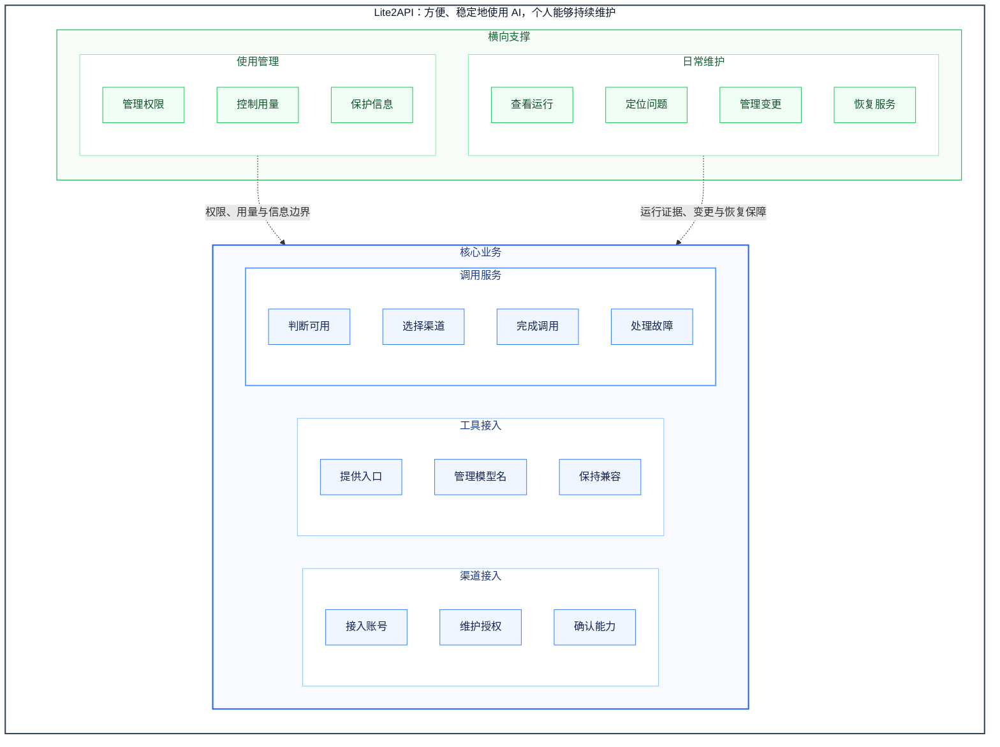

# Lite2API 业务能力图

> 2026-10-28 用户提供的目标蓝图。以下正文与 Mermaid 为验收依据，不表示全部目标已实现或已获真实运行验证。

## 目标与边界

项目约定：

1. 本文名称为“Lite2API 业务能力图”，描述个人 AI 网关在理想设计下需要具备的业务能力。
2. 项目的本质目标是：让个人使用的工具方便、稳定地调用合适的 AI，同时将配置、故障处理和日常维护控制在个人能够承担的范围内。
3. 本文组织的是目标能力，不将能力直接等同于管理页面、代码模块、适配器进程或微服务。
4. 核心业务与横向支撑用于区分角色，不构成额外的能力层级；每项能力具有唯一归属，可以共同支撑其他能力。

注：本文承接本轮持续讨论的 Lite2API。模板中的 MyLife-app 路径未作为项目资料来源。

业务范围：

1. 服务个人、单管理员、单机部署下的多渠道 AI 调用。
    * 使用者包括管理账号与服务的个人，以及其使用的聊天工具、编程工具、脚本和其他客户端。
    * 上游来源包括兼容 API、OAuth 账号，以及通过隔离适配器提供的其他访问方式。
2. 对访问来源、客户端接入、渠道选择、调用交付、使用边界和运行维护承担业务责任。
    * 第三方适配器可以承担认证和协议处理，系统仍需能够说明其提供什么能力、当前状态和故障影响。
    * 实际调用成功还依赖上游权限、额度、网络和服务状态。
3. 不承担商业计费、支付、多租户、团队组织管理和多节点一致性。
    * 不承诺任意协议之间自动转换。
    * 不将模型回答质量、代码正确性或用户任务最终完成，直接视为网关能够独立保证的结果。

设计依据：

1. 能力范围依据已读取的[项目说明](/root/Lite2API/README.md)、[适配器设计](/root/Lite2API/docs/ADAPTER_DESIGN.md)和本轮确认的个人项目背景。
2. 能力边界参考[迁移与接口审计](/root/Lite2API/docs/INTERFACE_AUDIT_2026-08-14.md)、[授权恢复记录](/root/Lite2API/docs/OAUTH_RECOVERY_2026-10-28.md)及当前代码中的能力、调度和响应处理。
3. 本文是目标蓝图，不将所有目标能力标记为已经实现，也不将源码存在、隔离测试通过和真实运行验收混为一体。

## 核心业务能力

渠道接入：

1. 接入账号：将已有 AI 访问来源纳入统一管理。
    * 范围包括来源登记、认证材料接入、连接信息维护、启用、停用和退出。
    * 区分实际认证账号、共享账号池和渠道连接，保留它们之间的关系。
    * 接入完成表示来源可以被识别和管理；是否能够完成目标调用，由能力确认和可用判断分别负责。
2. 维护授权：保持访问身份有效，并正确处理授权失效。
    * 范围包括有效期识别、授权更新、刷新结果确认、永久失效识别和重新授权要求。
    * 自动维护与用户操作具有明确边界；需要用户重新登录时，能够说明受影响的来源和能力。
    * 不把刷新操作成功直接等同于调用恢复，也不通过反复刷新掩盖永久失效。
3. 确认能力：明确每个来源能够提供什么。
    * 确认接口：明确支持的模型、调用接口及必要参数约定。
    * 确认特性：明确实际需要的流式、工具调用、图片输入、推理强度等特性；未使用的特性可以暂不扩展。
    * 保留依据：区分来源声明、实际验证、不支持和未知，并保留适用条件与验证时间。

注：渠道接入维护来源及其能力事实；运行时能否承接某次请求，归属于调用服务。

工具接入：

1. 提供入口：让客户端获得清楚、稳定、可验证的连接方式。
    * 范围包括访问地址、接口类型、认证方式、客户端配置说明和连接验证能力。
    * 客户端 Key 的签发与权限由使用管理负责，本能力负责让客户端正确使用。
    * 验收应覆盖实际使用的工具，不能只以配置文件生成成功作为完成依据。
2. 管理模型名：为客户端提供含义稳定的模型选择。
    * 范围包括对外模型名称、别名含义、上游映射，以及允许使用的替代来源。
    * 别名需要说明承诺的模型或能力范围，避免后台切换后悄悄降低必要功能。
    * 上游名称或渠道变化，尽量由网关侧承接；影响既有约定的变化需要明确处理。
3. 保持兼容：维护客户端能够依赖的调用约定。
    * 范围包括已支持接口的请求参数、响应格式、流式事件、错误格式及客户端必需行为。
    * 对无法满足的功能和参数给出明确处理规则，避免静默忽略必要要求。
    * 兼容范围以实际使用场景为边界，不扩大为对所有客户端、版本和协议的通用承诺。

注：工具接入定义对外约定；完成调用负责在实际请求中兑现这些约定。

调用服务：

1. 判断可用：判断哪些来源能够承接当前请求。
    * 综合请求所需能力、账号权限、授权状态、已知故障、额度阻断、冷却和容量情况。
    * 区分不支持、已知不可用、暂时满载、证据不足和允许尝试，避免压缩成单一健康标签。
    * 保留判断依据及时间；历史成功不能直接替代当前可用证明，未知额度不能解释为零。
2. 选择渠道：从符合要求的来源中确定调用目标和备用范围。
    * 先满足模型、接口、特性、访问权限和必要会话约束，再比较优先级、负载等偏好。
    * 备用来源需要符合相同调用约定；允许更换模型或降低能力时，需要有明确授权规则。
    * 区分账号数量与有效备用能力，关注多个来源是否共享额度、适配器或其他故障影响。
3. 完成调用：将符合约定的完整结果交付给客户端。
    * 范围包括请求内容传递、必要映射、普通与流式响应交付、客户端取消及调用结束确认。
    * 区分请求已发送、响应已开始、传输结束和调用完整完成。
    * 对需要的协议与特性定义完成条件，避免仅凭 HTTP 200 或连接正常结束判定成功。
4. 处理故障：为未完成的调用作出正确处置。
    * 区分故障：识别无候选、容量不足、授权拒绝、额度阻断、传输中断和提交结果不确定等情况。
    * 自动恢复：在条件明确、次数和时间有界的范围内等待、切换或请求授权刷新；不确定提交停止自动重放，已开始的流避免跨来源拼接。
    * 人工处理：明确无法自动恢复的原因、影响范围和必要操作，并保留重新验证的要求。

注：处理故障负责一次逻辑调用的处置；授权更新归渠道接入，服务版本、配置和持久状态的恢复归日常维护。

## 横向支撑能力

使用管理：

1. 管理权限：控制不同调用方能够使用什么。
    * 范围包括客户端身份、Key 的签发与撤销、有效期、模型权限，以及管理权限与调用权限的分离。
    * 所有保留的访问方式都具有明确规则，兼容入口和例外凭据也应纳入管理。
    * 权限变化需要能够实际影响后续访问，不能仅停留在页面状态。
2. 控制用量：将使用行为限制在可承担的范围内。
    * 范围包括请求频率、并发、请求大小、等待时间及其他必要资源边界。
    * 能够限制异常客户端或单个来源的影响，保护其他正常调用。
    * 上游额度用于识别使用限制；金额预算、价格比较等能力按真实需求扩展，不默认包含商业计费。
3. 保护信息：明确敏感信息可以被谁读取、返回和保留。
    * 范围包括客户端密钥、上游凭据、管理凭据、配置导出及请求观测数据。
    * 管理展示、错误提示和日志采用与用途匹配的信息范围，避免暴露不必要的认证材料和请求内容。
    * 对一次性密钥展示、授权导出等必要操作，明确接收者、权限和使用边界。

注：使用管理为核心业务提供权限、用量和信息边界，不负责判断模型能力或选择具体上游。

日常维护：

1. 查看运行：提供可信、可解释的运行事实。
    * 范围包括来源状态、调用结果、用量观测、资源使用和必要变更信息。
    * 明确数据来源、观测时间、统计范围、未知情况和保留边界。
    * 区分进程存活、来源可达和实际调用成功，避免用一种状态替代全部事实。
2. 定位问题：帮助维护者确定故障原因、影响和下一步行动。
    * 能够关联客户端调用、所选来源、必要尝试和最终结果。
    * 区分客户端配置、访问权限、渠道能力、上游授权、额度和运行故障。
    * 对无法确认的原因保留不确定性，并提供必要的验证方向。
3. 管理变更：控制账号、模型、路由、权限和服务版本的变化。
    * 范围包括变更校验、生效范围、配置与实际状态核对，以及变更影响确认。
    * 维护已有客户端约定和在途调用，避免通过配置变化绕过既有使用限制。
    * 能够识别未完成或相互冲突的变更，避免出现页面成功但实际状态不一致。
4. 恢复服务：在变更失败、服务异常或状态丢失后恢复必要能力。
    * 范围包括回滚、备份恢复、必要状态重建，以及恢复后的实际调用验证。
    * 明确恢复所需的配置、凭据和外部条件，不能仅以进程启动作为恢复完成。
    * 永久失效的外部授权仍由渠道接入处理，不以恢复旧文件替代重新授权。

注：日常维护支撑所有核心业务，但不替代实时调度和单次调用的故障处置。

## 能力归属与验收

关键职责边界：

1. 确认能力 → 维护来源能够提供什么；判断可用 → 判断该来源此时能否承接请求。
2. 管理模型名 → 定义对外名称与允许的替代范围；选择渠道 → 在这一范围内决定实际目标。
3. 保持兼容 → 定义客户端可以依赖的约定；完成调用 → 在具体请求中兑现约定。
4. 维护授权 → 管理身份有效性；管理权限 → 管理客户端和管理员可以做什么。
5. 查看运行 → 提供事实与证据；判断可用 → 使用相关事实作出调用判断。
6. 处理故障 → 处置一次逻辑调用；恢复服务 → 恢复服务配置、版本和必要状态。
7. 定位问题 → 说明原因、影响和行动依据；具体修复由对应能力承担。

关键支撑关系：

1. 使用管理 → 为渠道接入、工具接入和调用服务提供权限、用量与信息边界。
2. 日常维护 → 为核心业务提供运行证据、问题定位、受控变更和恢复保障。
3. 能力之间允许共享信息和相互调用，但共享机制不改变业务职责归属。

验收原则：

1. 以实际常用的客户端、模型、接口和特性组合确定首批验收范围，不以账号数、模型目录数或页面数量替代覆盖情况。
2. 以符合约定的逻辑调用完成情况检验核心业务。
    * 内部多次尝试仍归属于一次逻辑调用。
    * 属于声明服务范围但没有可用来源的调用，保留失败及原因，不通过排除样本美化结果。
3. 以接入耗时、人工介入频率、恢复耗时和日常维护投入检验维护负担。
4. 分别保留源码实现、隔离验证和实际运行验收的依据。
    * Agent 生成配置、执行检查或协助排障，属于交付与维护工作。
    * 只有能够由系统稳定提供的职责，才计入系统已经具备的业务能力。

图文约定：

1. Mermaid 展示一级能力域、二级业务能力及两项关键横向支撑关系。
2. 正文中确认能力与处理故障的三级子能力保留在文字中，避免图面过密。
3. 图中容器表示层级归属，虚线表示业务支撑；图中不表达调用顺序、状态转换或部署结构。

完整 Mermaid 源码：

