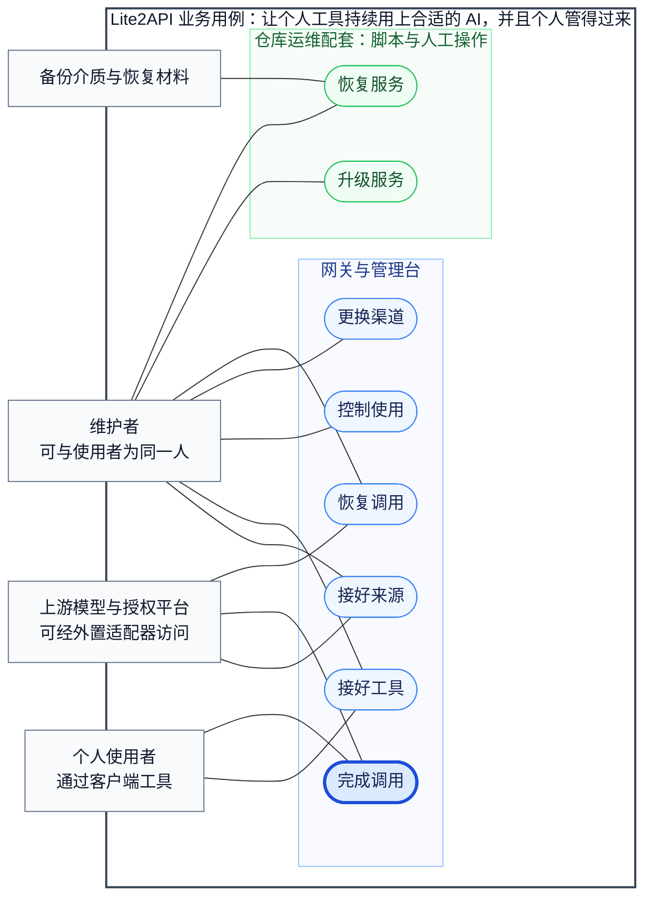

# Lite2API 业务用例

> 用户提供的目标与核查稿。文中 23:06 固定副本的失败是历史证据，保留原样；本轮源码与验收结果另见 BUSINESS_ALIGNMENT_ROUND2_2026-10-28.md，不互相覆盖。

## 目标与范围

本质目标：

1. 让个人拥有的 AI 访问来源，成为自己的工具可以持续使用的模型服务，并将日常维护控制在个人能够承担的范围内。
    * 容易接入：已有账号能够纳入管理，真实工具能够完成配置和首次调用。
    * 正确交付：请求交给符合要求的来源，客户端获得完整、符合约定的响应。
    * 持续使用：授权失效、渠道变化和调用故障具有明确处理方式。
    * 个人可维护：权限、用量、配置、升级和恢复具有可执行、可验证的管理边界。

业务范围：

1. 产品范围包括 Lite2API 网关、管理台及其对外置适配器的管理与调用。
    * 覆盖来源接入、客户端接入、模型选择、调用交付、访问控制、状态观测与异常处理。
    * OAuth、Cookie 和私有协议可以由外置适配器承担，实际能力仍需按来源核实。
2. 运维范围包括仓库提供的安装、升级、备份和校验工具，以及配套人工操作。
    * 升级与灾备恢复属于服务生命周期用例，不等同于网关管理台已经提供自动化功能。
3. 不包含商业计费、支付、多租户、团队权限和多节点一致性。
    * 不承诺任意协议自动转换。
    * 不独立保证模型回答正确、生成代码可用或使用者的最终任务完成。

参与者：

1. 使用者：通过聊天工具、编程工具或脚本调用 AI。
2. 维护者：管理账号、客户端权限、渠道规则和服务运行。
    * 个人项目中，使用者与维护者可以是同一个人，职责和操作权限仍需区分。
3. 客户端工具：提交请求，接收响应，执行自身的会话和工具调用逻辑。
4. 外部系统：提供模型能力、授权服务、适配器访问或备份存储。
    * 外部平台权限、额度及服务状态属于依赖条件，网关不能独立保证。

注：以下主条 1—8 为本稿核对仓库后确定的业务用例编号，不表示仓库原有需求编号。各用例描述目标设计，并分别说明当前依据和待补范围。

## 核心业务用例

日常使用与管理：

1. 接好来源：将一个 AI 访问来源变成可以管理、能够验证的调用资源。
    * 参与者与情境：维护者获得 API Key、OAuth 账号或适配器入口，希望纳入统一使用。
    * 前提：拥有必要访问资格；需要适配器时，已经具备相应运行条件。
    * 主成功判据：来源身份、认证归属和连接方式明确；至少一个目标调用组合完成验证；系统能够区分已验证、仅声明、不支持和未知的能力。
    * 业务范围：添加、导入、修改、停用和移除来源，维护授权，确认模型、接口及必要特性。
    * 例外边界：凭据保存或模型目录读取成功，不直接代表推理可用；批量导入允许部分成功时，必须核对逐项结果；外部授权不能完成时，不伪装成接入成功。
    * 支撑能力：接入账号、维护授权、确认能力、保护信息。
    * 当前依据：仓库已有账号导入、OAuth 管理和连接测试；当前工作区新增能力证据与特性描述，能够区分声明、验证和不支持等状态。[账号导入](/root/Lite2API/internal/gateway/accountimport.go)、[能力证据](/root/Lite2API/internal/config/capability_evidence.go)。
    * 理想设计补齐：将实际验证与能力记录关联，明确验证针对哪个来源、模型、接口和特性；提供维护者可理解的验收结果。不能把模型目录中的声明自动提升为验证事实。
2. 接好工具：让一个真实客户端能够使用所需 AI。
    * 参与者与情境：使用者希望让聊天工具、编程工具或脚本通过 Lite2API 工作，维护者提供接入配置。
    * 前提：目标工具的接口和必要功能要求清楚，至少存在允许使用的来源或明确的试用范围。
    * 主成功判据：工具获得正确的入口、凭据和模型选择，并完成其实际需要的调用。
    * 业务范围：选择对外模型名，分配客户端凭据，生成或提供配置，验证接口、响应格式及必要特性。
    * 例外边界：读取 `/v1/models` 只能验证部分鉴权与目录路径；配置生成成功不能证明工具已经可用；不支持的必要功能不能被静默忽略。
    * 支撑能力：提供入口、管理模型名、保持兼容、管理权限。
    * 当前依据：管理台已有 Claude、Codex、OpenAI SDK 和 curl 等配置生成逻辑；托管 Key 与模型目录提供接入基础。[客户端配置](/root/Lite2API/internal/web/app-clients.js)、[访问验证](/root/Lite2API/internal/gateway/clientkeys_access_test.go)。
    * 理想设计补齐：为常用工具建立明确的适配范围与验收场景。需要工具调用时，应验证必要的往返；需要流式时，应验证完整流。客户端执行工具的行为仍由客户端负责。
3. 完成调用：使一次请求得到符合约定的完整响应。
    * 参与者与情境：使用者通过客户端发起聊天、Responses、Messages、向量、图片或重排等受支持请求。
    * 前提：访问权限有效，请求符合接口要求；目标模型和必要特性具有明确约定。
    * 主成功判据：选中的来源满足本次要求，客户端获得符合接口结构和完成条件的响应；内部多次尝试仍归属于同一次逻辑调用。
    * 业务范围：检查权限与资源边界，判断候选来源，选择渠道，交付响应，处理取消和调用异常。
    * 例外边界：没有候选时及时失败；容量占满时有界等待；明确拒绝可以按规则切换；可能已经执行时停止自动重放；已开始的流不能更换来源拼接。
    * 能力边界：备用来源必须遵守原调用约定；未知能力是否允许尝试需要明确规则，未知不能被展示为已经支持；依赖上游会话状态的请求，必须另外判断是否允许换号。
    * 支撑能力：判断可用、选择渠道、完成调用、处理故障、控制用量。
    * 当前依据：工作区已有请求特性识别、已知不支持筛选、推理强度匹配和响应完成检查；相关源码与测试覆盖了普通响应及多种流式结束条件。[请求要求](/root/Lite2API/internal/gateway/request_requirements.go)、[完成检查](/root/Lite2API/internal/gateway/response_completion.go)。
    * 理想设计补齐：将完成判据落实到常用来源和真实客户端，验证工具调用、流式、错误与备用切换的组合行为。本次固定副本仍有一项缺模型回退回归失败，不能宣称该用例整体通过。
4. 控制使用：让不同工具只在允许、可承担的范围内使用 AI。
    * 参与者与情境：维护者新增工具、调整权限、发现异常消耗，或需要撤销某个工具的访问。
    * 前提：调用方能够被识别，访问凭据及其适用规则明确。
    * 主成功判据：允许的访问能够进行，禁止或超限的访问得到拒绝；权限调整、到期和撤销能够影响后续请求；单个工具的异常受到限制。
    * 业务范围：签发和管理客户端 Key，设置模型权限、频率、并发、有效期及必要请求资源边界。
    * 例外边界：拒绝访问不应产生上游调用；撤销后是否终止在途请求需要明确约定；兼容入口和应急凭据不能成为未说明的管理例外。
    * 支撑能力：管理权限、控制用量、保护信息、查看运行。
    * 当前依据：已有托管 Key 生命周期、模型权限、限流、并发和撤销实现，新增访问测试覆盖目录、实际请求及权限变化。legacy Key 仍具有独立规则，不能据托管 Key 能力推定所有入口受到相同限制。[Key 管理](/root/Lite2API/internal/gateway/clientkeys.go)、[访问控制回归](/root/Lite2API/internal/gateway/clientkeys_access_test.go)。
    * 理想设计补齐：明确每种凭据适用的管理规则，形成可核对的客户端使用范围。金额预算只在具备可信计量与实际需求后扩展，不将 Token 展示直接当作计费能力。
5. 更换渠道：在后台来源变化时保持客户端的使用约定。
    * 参与者与情境：维护者新增备用来源、替换不稳定渠道、调整偏好，或让某个账号退出使用。
    * 前提：受影响的模型别名、必要功能和客户端范围清楚，新来源的兼容依据可检查。
    * 主成功判据：变更后客户端继续使用约定的入口与模型选择，目标调用能够完成，已退出来源不再承接新的请求。
    * 业务范围：调整来源映射、候选集合、优先顺序和允许的备用关系，核对配置生效与实际调用结果。
    * 例外边界：替代来源无法满足原约定时，阻止静默降级；配置冲突或验证失败不能覆盖当前有效状态；在途调用如何结束应有明确处理规则。
    * 支撑能力：确认能力、管理模型名、保持兼容、选择渠道、管理变更。
    * 当前依据：已有显式目标链、模型映射、配置事务、热加载与跨代容量保持测试；删除账号时会处理路由引用。[配置事务](/root/Lite2API/internal/gateway/admin_transaction_test.go)、[账号退出](/root/Lite2API/internal/gateway/accountdelete_test.go)。
    * 理想设计补齐：提供变更影响检查，以同一工具的实际调用确认约定保持成立。单机热加载能力不直接等于所有变更零中断，也不能替代跨来源会话兼容验证。
6. 恢复调用：查清持续异常，并使受影响的 AI 能力重新可用。
    * 参与者与情境：使用者反馈失败，或维护者发现某项能力持续不可用，需要人工处理。
    * 前提：能够确定受影响的客户端、模型或调用范围；缺少证据时，能够明确需要补做的检查。
    * 主成功判据：原因和影响得到说明，修复后原失败范围重新完成调用；仍未恢复的来源和限制明确保留。
    * 业务范围：查看运行依据，定位配置、权限、授权、额度或服务问题，执行对应修复，验证恢复。
    * 例外边界：永久失效授权需要重新登录；外部权限和额度问题可能需要等待或人工处理；历史成功、刷新返回成功和进程健康不能单独证明恢复。
    * 职责边界：单次请求内的自动等待、换号和刷新属于“完成调用”；持续故障的人工处理属于本用例；模型能够回答不代表回答内容正确。
    * 支撑能力：查看运行、定位问题、维护授权、处理故障、管理变更。
    * 当前依据：已有 OAuth 恢复、错误来源区分与重新授权提示；工作区新增按调用范围保存观测、保留尝试记录及区分历史和新鲜证据的实现。[恢复实现](/root/Lite2API/internal/gateway/oauthrecovery.go)、[观测范围回归](/root/Lite2API/internal/gateway/evidence_test.go)。
    * 理想设计补齐：使维护者能够直接看到“影响什么、系统已做什么、还需做什么、怎样确认恢复”；修复后验证原失败的接口和特性，避免用另一种调用的成功掩盖故障。

注：正确拒绝、明确失败和报告提交不确定，属于正确处理结果，但不计作调用成功。当前源码允许尝试未知能力，也不能因此把未知能力计入已验证服务范围。

## 服务生命周期用例

升级与恢复：

7. 升级服务：完成版本或适配器更新，并保留退回可用状态的能力。
    * 参与者与情境：维护者需要修复问题、适应上游变化或引入已经确定的新能力。
    * 前提：目标版本、变更范围、恢复材料和可接受维护窗口明确。
    * 主成功判据：更新后关键客户端调用和访问边界通过验收；更新失败时，能够退回兼容的可用版本与必要状态。
    * 业务范围：版本确认、变更检查、恢复点准备、安装更新、实际能力验证和失败回退。
    * 例外边界：程序启动成功只能证明存活；配置或凭据发生不兼容变化时，仅替换旧二进制未必能够恢复；外置适配器需要独立核对版本和补丁。
    * 支撑能力：管理变更、查看运行、定位问题、恢复服务。
    * 当前依据：systemd 安装器从已提交版本构建，具有旧二进制、unit 和服务状态恢复逻辑；核心安装器成功门禁主要检查 `/livez`，不能替代模型调用验收。未提交的新实现也不会自动进入该发布产物。[核心安装器](/root/Lite2API/deploy/install-lite2api-systemd.sh)。
    * 理想设计补齐：将关键调用、权限边界和必要状态兼容性纳入发布验收，明确自动回退覆盖哪些文件和状态。本轮未执行升级或回退演练。
8. 恢复服务：从故障或备份中重建能够实际调用的服务。
    * 参与者与情境：维护者遇到环境损坏、配置或凭据丢失、误操作，或需要迁移运行环境。
    * 前提：具备可读取的恢复材料、必要解密条件和外部访问资格。
    * 主成功判据：关键配置、客户端访问规则和来源状态恢复；真实客户端能够完成关键调用；缺失和未恢复部分明确。
    * 业务范围：备份范围确认、材料校验、状态还原、依赖重建，以及权限和调用验证。
    * 例外边界：备份缺少 Key 元数据可能导致既有客户端凭据失效；已经撤销或过期的上游授权不能靠恢复旧文件保证可用；升级快照不能替代完整灾备。
    * 支撑能力：恢复服务、保护信息、管理变更、维护授权。
    * 当前依据：仓库提供 systemd 和 Compose 的加密备份、归档校验工具及恢复说明；本次归档校验夹具通过，但夹具使用模拟的 `age`，未证明真实加解密或完整灾备成功。[备份脚本](/root/Lite2API/deploy/server-ops/backup-configs.sh)、[校验夹具](/root/Lite2API/deploy/backup-verifiers.test.sh)。
    * 理想设计补齐：在隔离环境执行完整恢复，核对配置、客户端 Key、适配器凭据和实际调用。跨文件一致性、异地材料可得性及恢复耗时，需要实操形成证据。

注：“升级服务”和“恢复服务”属于仓库运维配套范围。当前存在脚本与说明，不等于已经具有完整自动化恢复能力。

## 用例关系与验收要求

职责归属：

1. 接好来源 → 建立可以管理和验证的访问资源。
2. 接好工具 → 建立客户端能够依赖的连接与调用约定。
3. 完成调用 → 兑现日常使用的主要价值。
4. 控制使用 → 约束谁能使用、可以使用什么以及资源边界。
5. 更换渠道 → 在来源变化时保持对外约定。
6. 恢复调用 → 解决持续故障，恢复具体使用能力。
7. 升级服务 → 支撑服务安全演进。
8. 恢复服务 → 支撑环境或持久状态故障后的重建。

必要验收：

1. 开始使用：来源接入与真实工具接入分别具有验收结果。
    * 关注首次成功使用需要的配置、操作与人工判断。
2. 日常调用：覆盖实际需要的模型、接口、流式及其他特性。
    * 关注完整结果，不能只检查 HTTP 状态或模型目录。
3. 故障处置：覆盖无候选、满载、明确拒绝、授权失效、提交不确定和流中断。
    * 检查恢复动作、上游尝试次数、错误含义和资源释放。
4. 使用控制：覆盖允许访问、禁止访问、超限、过期、撤销及兼容入口。
    * 规则必须在实际请求中生效。
5. 变更与恢复：覆盖来源更换、持续异常修复、升级回退和备份还原。
    * 每种变更都以受影响能力的实际验证结束。

评价口径：

1. 以符合约定的逻辑调用完成情况评价服务价值。
    * 内部重试和换号仍属于同一次逻辑调用。
    * 声明服务范围内没有可用来源的请求，应保留失败及原因。
2. 以接入耗时、人工介入频率、恢复耗时和日常维护投入评价个人维护负担。
    * 账号数量、模型目录数量和重试次数，只能作为解释性数据。
3. 网关负责调用契约和交付，不将模型回答质量直接计为自身保证。
    * 使用者任务是否完成，需要客户端或任务评估提供额外依据。

## 证据与当前限制

核查基准：

1. 已核对主机名 `ser451803379164` 与项目目录 `/root/Lite2API`。
2. 已提交基线为 `9956f77`，工作区包含正在变化的未提交实现。
    * 本稿验证采用北京时间 2026 年 10 月 28 日 23:06:28 的固定源码副本，复制后核对未发现复制期间变化。
    * 后续工作区又有修改，不自动继承该副本的验证结果；也不能用旧提交的通过记录证明新工作区通过。
3. 本轮只检查源码、文档和隔离测试，未读取生产配置、调用生产模型、部署服务或执行灾备恢复。

验证结果：

1. 固定副本执行 `go test -race ./... -count=1 -json`，含子测试有 340 个通过事件，1 项失败，整套退出码为 1。
    * 失败项为 `TestGatewayUsesOrderedTargetsAndFallsBackOnMissingModel`，实际返回 502 `invalid_upstream_response`。
    * 因此只能说明相应用例存在实现和部分验证，不能宣称当前调用与回退能力全部验收通过。
2. 两个前端逻辑测试文件通过。
3. 备份归档校验夹具通过，适用范围限于其模拟输入和检查契约。
4. 早期副本的失败与后续修改分开保留，不将不同版本结果合并成一次通过。

注：源码摘要、命令、原始输出、早期失败及验证边界见[本次业务用例验证记录](/root/Lite2API/docs/evidence/lite2api-usecases-20261028-230628/validation.json)。

图文约定：

1. Mermaid 节点使用通俗用例名称，与正文主条逐项对应。
2. 系统边界区分网关及管理台功能、仓库运维配套。
3. 连线表示参与关系，不表示固定执行顺序；图中目标用例不代表当前全部实现或验证完成。

完整 Mermaid 源码：

